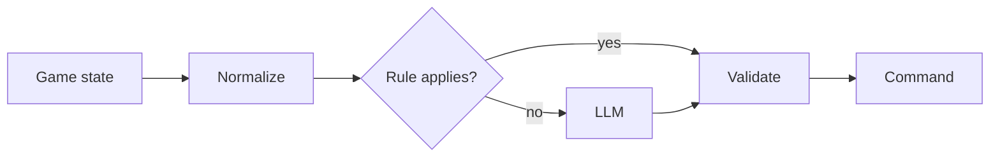

# Agentic Football: a 5-agent AI team on Amazon Bedrock AgentCore


Five AI agents, one per player, playing live 5v5 football matches against other teams' agents and against
human-coached teams. Each player is its own **AgentCore runtime**. The game server calls it every tick with
the full game state, and it must answer within the ~2-second tick with one command: move, pass, shoot,
press, mark, tackle and so on.

The team started from the AWS sample agents and was improved **between matches during a tournament**. After
every match we read the logs, found what went wrong, fixed it, tested it offline and redeployed.

## The squad

| # | Position | Model | Deterministic rules (run before the model) |
|---|----------|-------|---------------------------------------------|
| 0 | Goalkeeper | Nova Micro | Loose ball in our box: intercept. Distribution to the most advanced *open* teammate (throw short, kick long) |
| 1 | Defender | Nova Lite | Own-half release, shoot when in range, hold the defensive shape when we have the ball |
| 2 | Midfielder | Nova 2 Lite | Own-half release, shoot when in range |
| 3 | Forward 1 | Nova Lite | Own-half release, shoot when in range, support run ahead of the ball |
| 4 | Forward 2 | Nova Lite | Own-half release, shoot when in range, poacher run to the far side |

Models were chosen by measurement (`afc_tools/model_eval.py`): the same real match states were sent to
each candidate and the replies were scored for validity, quality and latency. Bigger models did not play
better, and at a 2-second tick they were often too slow.

## How a decision is made



1. **Normalize.** Server units are converted, and the away side sees the pitch rotated 180°, so every agent
   plays the same way on either side ([`lib/frame.py`](lib/frame.py)).
2. **Rules first.** Clear-cut situations (shot in range, loose ball in our box, keeper distribution) are
   decided by deterministic rules ([`lib/rules.py`](lib/rules.py)). Everything else goes to the LLM.
3. **Validate.** Every command is checked against the game's contract. If it is invalid, a rule-based
   fallback answers instead, so a player never freezes ([`lib/action_validator.py`](lib/action_validator.py)).

## Repository layout

```
├── lib/                          # shared library used by every agent
│   ├── agent_base.py             #   invoke handler: normalize → rules → model → validate
│   ├── rules.py                  #   deterministic tactical rules and output filters
│   ├── frame.py                  #   server ↔ design units, home view for the away side
│   ├── state.py                  #   game state → compact text summary for the model
│   ├── possession.py, stamina.py #   possession inference, stamina reading
│   └── action_schema.py, action_validator.py
├── ai-team-strands-balanced/     # the team that plays (5 AgentCore runtimes + CDK)
├── ai-team-strands-*/            # other sample teams from upstream (aggressive, defensive, gateway, memory)
├── afc_tests/                    # 213 offline tests (no network, no AWS) incl. real captured states
├── afc_tools/                    # match monitor, log fetcher, model evaluation, e2e checks, simulator
├── afc_iam/                      # least-privilege IAM policies for deploying
├── AFC_RUNBOOK.md                # every change, measurement and deployment, match by match
└── AFC_MATCHDAY_CHECKLIST.md     # match-day checklist (Spanish)
```

## Quick start

**Run the tests (offline, free):**

```bash
pip install strands-agents
cd afc_tests
python -m unittest discover
```

**Play a simulated match through the real pipeline (offline):**

```bash
python afc_tools/sim_match.py
```

**Deploy the team to your AWS account:** follow
[`ai-team-strands-balanced/README.md`](ai-team-strands-balanced/README.md) (AgentCore CLI + CDK). Put
your account in `ai-team-strands-balanced/agentcore/aws-targets.json` and make sure Bedrock access to the
Amazon Nova models is enabled. Then register the five runtime ARNs on the tournament portal.

**Watch a live match from the runtime logs:**

```bash
python afc_tools/match_watch.py --minutes 5
```

> Account IDs in the docs and reports are redacted as `<EVENT_ACCOUNT_ID>` / `<PERSONAL_ACCOUNT_ID>`.

## Credits

Built on the agentic football sample agents from
[`aws-samples/sample-ai-possibilities`](https://github.com/aws-samples/sample-ai-possibilities)
(MIT-0). Agents use the [Strands Agents SDK](https://github.com/strands-agents/sdk-python) and run on
[Amazon Bedrock AgentCore](https://docs.aws.amazon.com/bedrock-agentcore/).

## License

[MIT-0](LICENSE)
